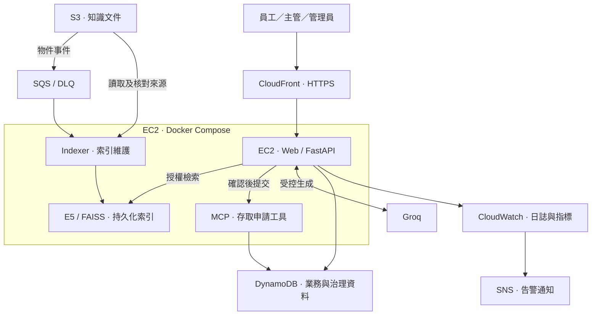

# RoleOps Control Tower

### 讓企業 AI 在角色權限、有效知識與主管審核的範圍內協助工作

RoleOps 是 AWS 雲端工程師培訓的實作專題，整合 **角色導向助理、RAG 知識檢索、MCP 存取申請與治理維運**。以客服、IT、CRM 申請和管理員四條路線，展示從「取得工作指引」到「受控建立申請、主管審核、原單回查」的流程。

**Python / FastAPI · AWS · E5 / FAISS · Groq · MCP · Docker Compose**

## 成果展示

**[觀看專題展示影片（Google Drive）](https://drive.google.com/file/d/1rquCmsrJ6von0V3GhVpVN7F95xZCSd9a/view?usp=sharing)**　建議按住 **Ctrl**（Mac：**⌘**）點擊，或用滑鼠中鍵，以新分頁觀看。

影片為專題錄製成果；本 repo 提供公開作品版程式與本機操作方式。可先觀看影片，再依下方案例、架構與程式入口了解設計。

> 本 repo 為可在本機執行的公開作品版，版本為 `portfolio-013.009`。本機使用合成文件、模擬向量與合成回覆；AWS 展示環境使用 E5、FAISS 與 Groq。兩種模式的驗證範圍請見[驗證與限制](docs/verification.md)。

[功能與展示](#功能與展示) · [個人貢獻與協作方式](#個人貢獻與協作方式) · [工程設計重點](#工程設計重點) · [系統架構](#系統架構) · [本機啟動](#本機啟動) · [驗證與限制](docs/verification.md)

## 為什麼做這個專題

企業員工需要查制度、整理案件、申請軟體權限，但這些事情涉及不同的知識範圍與決策責任。RoleOps 將工作協助接到既有授權與簽核流程，並保留可追查的來源和業務狀態。

| 工作問題 | RoleOps 的處理方式 |
| --- | --- |
| 不同職務能讀取的公司資料不同 | 後端依員工身分、部門、職務方案與助理派任計算有效範圍 |
| 舊版規定可能與現行制度混用 | 檢索核對來源版本與內容雜湊，封存版本另行排除 |
| AI 回答需要有具體依據 | AWS/Groq 路徑對受支援情境採用版本綁定事實、輸出契約與涵蓋檢查 |
| 聊天中的申請意圖可能被誤當成已完成作業 | 分開呈現提案、員工確認、建單結果與主管決策 |
| 連線逾時後不知道有沒有建單 | 以原識別碼重試及回查，顯示結果待確認 |
| 系統出錯後需要追查原因 | 保留治理事件、trace、服務自檢與維運展示入口 |

## 功能與展示

Mentor 與 Dispatcher 是介面中的工作角色：Mentor 提供知識與操作指引，Dispatcher 呈現任務與申請派送。實際存取與業務動作由後端執行授權檢查。

| 展示路線 | 代表情境 | 可以觀察的成果 |
| --- | --- | --- |
| **客服工作助理** | 客戶主張設備兩次停機，要求退款 | 整理案件事實、資訊缺口、政策選項及主管待決事項；可接續整理呈核摘要 |
| **IT 工作助理** | 再次告警前需要確認哪些條件？ | 依現行手冊提供檢查指引；區分歷史案例與本次尚未確認的現場事實 |
| **CRM 存取申請** | 因工作需要申請 CRM | 提案 → 員工確認 → `pending` → 主管決策 → 員工以同單號回查 |
| **管理員治理與維運** | 追查越權請求、檢視服務狀態 | 人員與助理派任、申請審核、治理事件、自檢及維運紀錄 |

**業務邊界：** 唯一 MCP 業務工具是 `create_access_request`。主管核准後的實際帳號開通由外部系統處理；客服呈核摘要沿用既有簽核管道，系統沒有退款執行工具。

完整操作、示例問題與各模式預期差異見[展示操作指南](docs/demo.md)。

## 個人貢獻與協作方式

專題作者負責推進需求定義、方案取捨、AWS 建置操作、問題回報與展示驗收；AI 協助程式實作、文件撰寫及測試。以下以實際工作範圍說明分工：

| 工作範圍 | 作者的參與 |
| --- | --- |
| 需求與流程 | 定義客服、IT、CRM 與管理員情境，確認角色、派任、簽核責任及操作體驗 |
| 方案取捨 | 在 Bedrock 配額、專題成本與操作條件下參與替代方案評估，確認採用 Groq + E5 / FAISS |
| AWS 建置與排查 | 依操作手冊建立服務、操作 CloudShell／Session Manager，回傳現場結果並核對修復 |
| 展示與驗收 | 操作員工提問、申請、主管審核、原單回查及管理員頁面，提出並確認修正需求 |

## 工程設計重點

以三個企業應用問題說明主要設計；程式與測試入口供進一步檢閱，各項驗證範圍見[驗證紀錄](docs/verification.md)。

| 問題 | 設計處理 | 程式與測試入口 |
| --- | --- | --- |
| **員工能否取得超出職務範圍的資料或操作？** | 後端依身分與助理派任限制檢索和業務範圍；MCP 驗證後端簽署身分，再檢查授權。Prompt 無法授予權限。 | [業務契約](app/domain.py)／[MCP](mcp_server/server.py)／[邊界測試](tests/test_boundaries.py) |
| **規範更新後，舊回答或未送出的提案怎麼處理？** | 綁定政策版本、來源雜湊與索引 generation；生成與保存前後核對來源和授權，條件改變時中止。Groq 路徑另檢查事實映射與必要資訊涵蓋。 | [知識檢索](app/knowledge.py)／[問答協調](app/agent.py)／[事實映射測試](tests_extension/test_wire_facts.py) |
| **申請送出逾時，如何避免重複建單？** | 分開處理提案、本人確認、建單與主管決策；以原申請鍵回查和處理重試，逾時先保留結果待確認。 | [業務契約](app/domain.py)／[MCP 測試](tests/test_mcp.py)／[可靠性測試](tests/test_reliability_unittest.py) |

Indexer 另處理文件更新事件的去重、鎖定、退避及索引完整性；失敗訊息與成功問答歷史分開保存。受控生成目前涵蓋指定合成情境，尚未驗證任意企業文件的泛化能力。

## 系統架構

下圖描述 AWS 展示環境的服務分工；公開 repo 的本機模式會替換雲端資料存取與模型呼叫。



SQS 傳遞文件更新事件；Indexer 讀取 S3 實際來源、核對版本並維護 FAISS。員工問答由 Web 後端讀取索引與檢查來源，SQS 不參與每次回答的判斷。

詳見[架構、資料流與技術決策](docs/architecture.md)。

## 技術選型與取捨

| 決策 | 選擇理由 | 承擔的限制 |
| --- | --- | --- |
| **E5 + FAISS** | Bedrock Embeddings 配額受限後，採本地多語向量模型與持久化索引；E5 為 384 維 | 自行維護模型資產、磁碟、來源一致性及索引重建 |
| **Groq 生成** | 將生成與向量模型分開，維持後端證據與工具契約；目前設定為 openai/gpt-oss-20b | 需處理速率限制、輸出格式與供應商失敗 |
| **單一 MCP 業務工具** | 聚焦 create_access_request，完成可追查的申請、核准與回查流程 | 未串接真實 CRM 開通，也未提供退款或其他業務工具 |
| **EC2 + Docker Compose 三服務** | 在專題成本與操作條件內，區分 Web、MCP、Indexer 責任 | 共用單一主機，尚無跨可用區高可用能力 |
| **公開版本機合成模式** | 讓讀者無須 AWS 帳號或模型憑證即可操作流程 | 本機體驗無法評估真實 E5／Groq 的品質、延遲與成本 |

Web 採 Python / FastAPI；S3 保存知識來源，SQS 傳遞更新事件，DynamoDB 保存業務與治理資料，CloudFront／CloudWatch／SNS 提供入口、觀測與通知。公開程式保留部分 Bedrock 相容路徑，現行 AWS 設定檢查要求 Groq + E5。

## 驗證成果與範圍

| 驗證層次 | 已有紀錄與閱讀方式 |
| --- | --- |
| **本機契約測試** | 首發基線於 2026-11-13 記錄 209 個測試與 48 個子測試通過，使用合成資料及服務替身；近期完整重跑受 E5／Windows FAISS 環境問題阻礙，尚未取得完整結果。 |
| **AWS 展示** | 作者已操作並回報客服／IT 指引、CRM 申請與審核回查、越權及管理員展示通過；屬指定情境驗收。 |
| **待補證據** | 任意企業文件評測、正式容量與高可用、外部開通整合，以及各項告警觸發與通知送達驗收。 |

詳細測試指令、案例入口及適用限制見[驗證紀錄](docs/verification.md)。影片呈現錄製時成果；即時 AWS 服務未提供持續在線的公開入口。

## 本機啟動

需要 **Python 3.12**。以下指令在 clone 後的 repo 根目錄執行；建議使用獨立虛擬環境。

```bash
git clone https://github.com/copudy/roleops-control-tower.git
cd roleops-control-tower
python -m venv .venv
```

啟用虛擬環境：

| 環境 | 指令 |
| --- | --- |
| Windows PowerShell | `.\.venv\Scripts\Activate.ps1` |
| macOS / Linux | `source .venv/bin/activate` |

```bash
python -m pip install -r requirements.lock
python launch_local.py
```

開啟 **http://127.0.0.1:8000**。首次進入時自行建立管理員，接著依[展示指南](docs/demo.md)建立員工、助理與派任。沒有共用的預設帳號密碼。

啟動器建立本機設定 `.env.local`、啟動三個服務，資料與日誌寫入 `runtime/`。按 **Ctrl+C** 停止。首次需等待 Indexer 建立索引；若啟動失敗，檢查 `runtime/web.log`、`runtime/mcp.log`、`runtime/indexer.log`。

本機啟動流程不需要 AWS 帳號、Groq Key 或 E5 模型下載。本機合成回覆用來展示操作流程，Groq 事實選取與涵蓋檢查另由隔離測試驗證。

## 驗證與程式導覽

測試安裝、執行方式、結果及限制見[驗證紀錄](docs/verification.md)。

| 入口 | 內容 |
| --- | --- |
| [app/web.py](app/web.py)、[app/domain.py](app/domain.py) | API、身分與業務契約 |
| [app/agent.py](app/agent.py) | 問答協調、生成後檢查、MCP 呼叫 |
| [app/knowledge.py](app/knowledge.py)、[indexer/worker.py](indexer/worker.py) | 來源檢索、索引完整性及更新事件 |
| [app/generation.py](app/generation.py)、[app/grounding.py](app/grounding.py) | 生成輸出契約與版本綁定事實 |
| [mcp_server/server.py](mcp_server/server.py) | 唯一存取申請工具 |
| [static/](static/) | 對話、簽核、助理管理與維運介面 |
| [knowledge/](knowledge/)、[prompts/](prompts/) | 合成知識文件與 A／B／C 提示版本 |
| [tests/](tests/)、[tests_extension/](tests_extension/) | 核心及擴展測試 |

## 作品範圍

這是一個學習與作品展示專題，公開內容包含應用程式、合成教材與本機啟動入口。AWS 環境參數、憑證、原始維運收據與部署套件保留於私有專案；展示影片由上方連結提供。

AWS 架構目前採單一 EC2，未建置跨可用區高可用服務。公開版的資料還原身分檢查含佔位值，AWS 部署及還原仍需環境專用設定。問答依據的合成文件與情境有界，尚未驗證任意企業文件的泛化能力。

後續優先擴充獨立評測集與可公開重現的驗證，再評估外部開通整合及高可用；各項目前限制見[驗證紀錄](docs/verification.md)。
