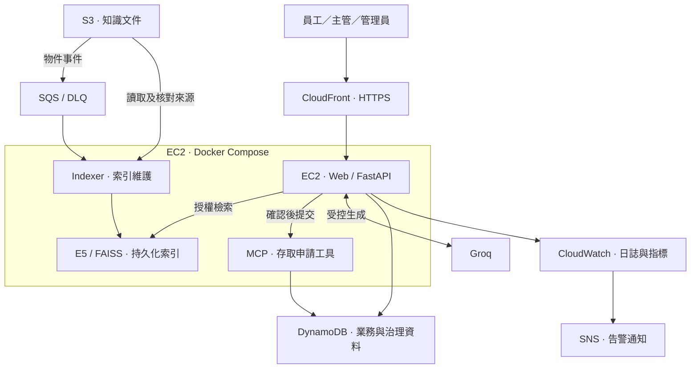

# RoleOps Control Tower

### 讓企業 AI 在角色權限、有效知識與主管審核的範圍內協助工作

RoleOps 是 AWS 雲端工程師培訓的實作專題，整合 **角色導向助理、RAG 知識檢索、MCP 存取申請與治理維運**。以客服、IT、CRM 申請和管理員四條路線，展示從「取得工作指引」到「受控建立申請、主管審核、原單回查」的流程。

**Python / FastAPI · AWS · E5 / FAISS · Groq · MCP · Docker Compose**

> 本 repo 為可在本機執行的公開作品版，版本為 `portfolio-013.009`。本機使用合成文件、模擬向量與合成回覆；AWS 展示環境使用 E5、FAISS 與 Groq。兩種模式的驗證範圍請見[驗證與限制](docs/verification.md)。

[功能與展示](#功能與展示) · [系統架構](#系統架構) · [本機啟動](#本機啟動) · [展示操作指南](docs/demo.md) · [工程驗證](docs/verification.md)

## 為什麼做這個專題

企業員工需要查制度、整理案件、申請軟體權限，但這些事情涉及不同的知識範圍與決策責任。RoleOps 將工作協助接到既有授權與簽核流程，並保留可追查的來源和業務狀態。

| 工作問題 | RoleOps 的處理方式 |
| --- | --- |
| 不同職務能讀取的公司資料不同 | 後端依員工身分、部門、職務方案與助理派任計算有效範圍 |
| 舊版規定可能與現行制度混用 | 檢索核對來源版本與內容雜湊，封存版本另行排除 |
| AI 回答需要有具體依據 | AWS/Groq 路徑對受支援情境採用版本綁定事實、輸出契約與涵蓋檢查 |
| 聊天中的申請意圖可能被誤當成已完成作業 | 分開呈現提案、員工確認、建單結果與主管決策 |
| 連線逾時後不知道有沒有建單 | 以原識別碼重試及回查，顯示結果待確認 |
| 系統出錯後需要追查原因 | 保留治理事件、trace、服務自檢與維運展示入口 |

## 功能與展示

Mentor 與 Dispatcher 是介面中的工作角色：Mentor 提供知識與操作指引，Dispatcher 呈現任務與申請派送。實際存取與業務動作由後端執行授權檢查。

| 展示路線 | 代表情境 | 可以觀察的成果 |
| --- | --- | --- |
| **客服工作助理** | 客戶主張設備兩次停機，要求退款 | 整理案件事實、資訊缺口、政策選項及主管待決事項；可接續整理呈核摘要 |
| **IT 工作助理** | 再次告警前需要確認哪些條件？ | 依現行手冊提供檢查指引；區分歷史案例與本次尚未確認的現場事實 |
| **CRM 存取申請** | 因工作需要申請 CRM | 提案 → 員工確認 → `pending` → 主管決策 → 員工以同單號回查 |
| **管理員治理與維運** | 追查越權請求、檢視服務狀態 | 人員與助理派任、申請審核、治理事件、自檢及維運紀錄 |

**業務邊界：** 唯一 MCP 業務工具是 `create_access_request`。主管核准後的實際帳號開通由外部系統處理；客服呈核摘要沿用既有簽核管道，系統沒有退款執行工具。

完整操作、示例問題與各模式預期差異見[展示操作指南](docs/demo.md)。

## 系統架構

下圖描述 AWS 展示環境的服務分工；公開 repo 的本機模式會替換雲端資料存取與模型呼叫。



SQS 傳遞文件更新事件；Indexer 讀取 S3 實際來源、核對版本並維護 FAISS。員工問答由 Web 後端讀取索引與檢查來源，SQS 不參與每次回答的判斷。

詳見[架構、資料流與技術決策](docs/architecture.md)。

## 工程設計重點

- **授權落在後端：** 頁面功能、API、知識檢索與 MCP 呼叫各有檢查；MCP 身分來自後端簽署的 HTTP 上下文。
- **來源與回答可追溯：** 文件 ID、政策版本、內容雜湊與索引 generation 連結到回答來源；生成期間若授權或來源變更，後端中止該次處理。
- **受控生成：** Groq 路徑將模型選取的事實映回檢索證據，核對格式及必要資訊涵蓋；目前適用於受支援的合成情境，涵蓋規則有明確邊界。
- **申請保持可回查：** 員工確認後才透過 MCP 建單，以冪等鍵處理重試，主管決策和員工回查共用原申請。
- **失敗狀態獨立保存：** 模型失敗提示與成功的問答歷史分開；只有符合既有證據及完整性條件的指引，才允許採已驗來源回覆。
- **索引更新可檢查：** 事件去重、鎖定、退避、失敗保留與索引完整性檢查都有程式及測試入口。

## 技術選型與取捨

| 元件 | 用途與選擇 |
| --- | --- |
| Python / FastAPI | Web API、授權、工作流程及治理事件 |
| E5 multilingual small | AWS 模式的本地多語向量模型，384 維 |
| FAISS | 持久化向量索引與檢索；需自行管理一致性及重建 |
| Groq | AWS 模式的生成服務；目前設定為 `openai/gpt-oss-20b` |
| MCP / LangChain | 受控單一工具呼叫與業務建單 |
| S3 / SQS / DynamoDB | 知識來源、更新事件、業務與治理資料 |
| EC2 / Docker Compose | Web、MCP、Indexer 三服務運行；目前為單機架構 |
| CloudFront / CloudWatch / SNS | HTTPS 入口、觀測及告警通知 |

專題建置曾受 Bedrock Embeddings 配額限制，改採本地 E5；生成採 Groq。公開程式保留部分 Bedrock 相容路徑，現行 AWS 設定檢查要求 Groq + E5。

## 本機啟動

需要 **Python 3.12**。以下指令在 clone 後的 repo 根目錄執行；建議使用獨立虛擬環境。

```bash
git clone https://github.com/copudy/roleops-control-tower.git
cd roleops-control-tower
python -m venv .venv
```

啟用虛擬環境：

| 環境 | 指令 |
| --- | --- |
| Windows PowerShell | `.\.venv\Scripts\Activate.ps1` |
| macOS / Linux | `source .venv/bin/activate` |

```bash
python -m pip install -r requirements.lock
python launch_local.py
```

開啟 **http://127.0.0.1:8000**。首次進入時自行建立管理員，接著依[展示指南](docs/demo.md)建立員工、助理與派任。沒有共用的預設帳號密碼。

啟動器建立本機設定 `.env.local`、啟動三個服務，資料與日誌寫入 `runtime/`。按 **Ctrl+C** 停止。首次需等待 Indexer 建立索引；若啟動失敗，檢查 `runtime/web.log`、`runtime/mcp.log`、`runtime/indexer.log`。

本機啟動流程不需要 AWS 帳號、Groq Key 或 E5 模型下載。本機合成回覆用來展示操作流程，Groq 事實選取與涵蓋檢查另由隔離測試驗證。

## 驗證與程式導覽

測試安裝、執行方式、結果及限制見[驗證紀錄](docs/verification.md)。

| 入口 | 內容 |
| --- | --- |
| [app/web.py](app/web.py)、[app/domain.py](app/domain.py) | API、身分與業務契約 |
| [app/agent.py](app/agent.py) | 問答協調、生成後檢查、MCP 呼叫 |
| [app/knowledge.py](app/knowledge.py)、[indexer/worker.py](indexer/worker.py) | 來源檢索、索引完整性及更新事件 |
| [app/generation.py](app/generation.py)、[app/grounding.py](app/grounding.py) | 生成輸出契約與版本綁定事實 |
| [mcp_server/server.py](mcp_server/server.py) | 唯一存取申請工具 |
| [static/](static/) | 對話、簽核、助理管理與維運介面 |
| [knowledge/](knowledge/)、[prompts/](prompts/) | 合成知識文件與 A／B／C 提示版本 |
| [tests/](tests/)、[tests_extension/](tests_extension/) | 核心及擴展測試 |

## 作品範圍

這是一個學習與作品展示專題，公開內容包含應用程式、合成教材與本機啟動入口。AWS 環境參數、憑證、原始維運收據、部署套件與私人影片保留於私有專案。

AWS 架構目前採單一 EC2，未建置跨可用區高可用服務。公開版的資料還原身分檢查含佔位值，AWS 部署及還原仍需環境專用設定。問答依據的合成文件與情境有界，尚未驗證任意企業文件的泛化能力。

開發採 AI 協作方式，由專題作者推進需求、方案取捨、AWS 操作與展示驗收，AI 協助程式、文件及測試工作。工程與驗收範圍依[驗證紀錄](docs/verification.md)分開列示。
