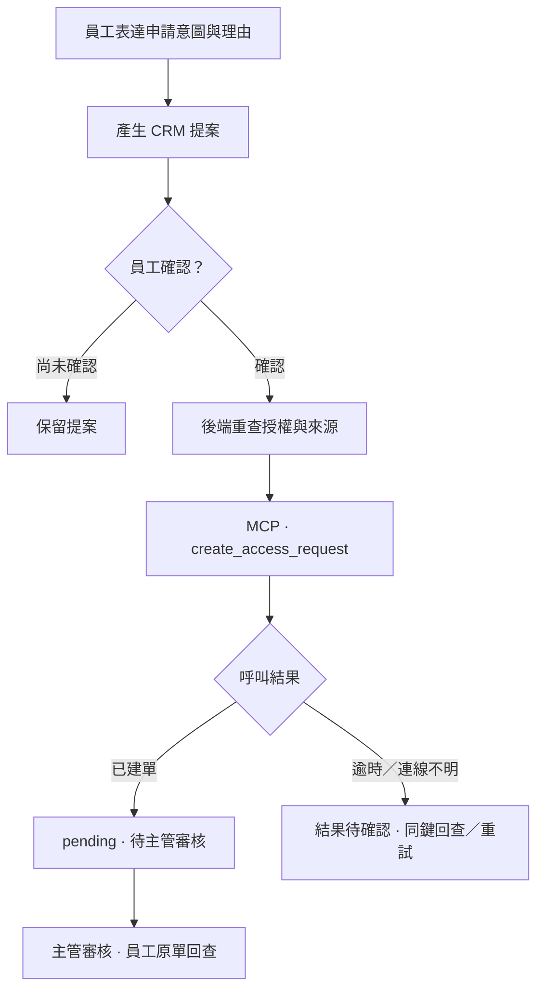
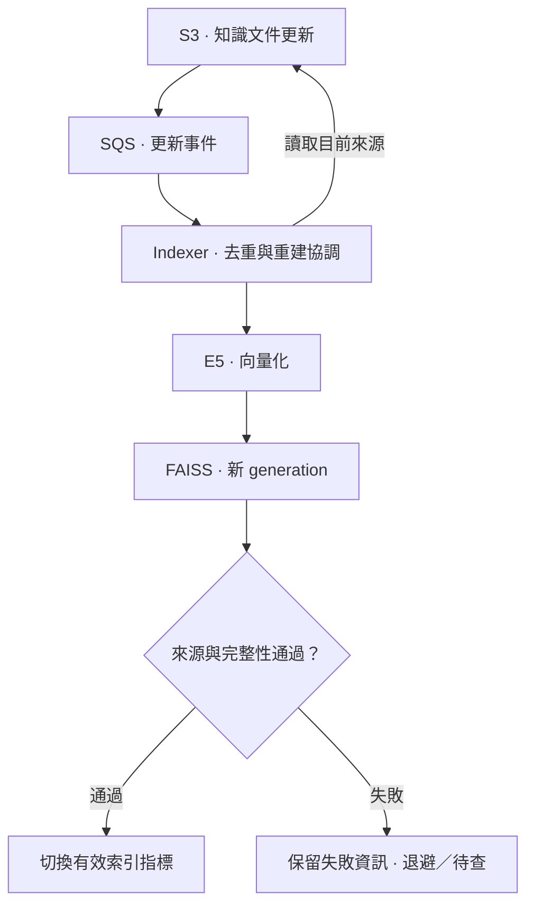

# 架構、資料流與技術決策

[返回 README](../README.md)

## 服務責任

| 元件 | 責任 | 程式入口 |
| --- | --- | --- |
| Web | 登入、有效授權、對話、來源檢索、生成協調、申請確認及治理介面 | [web.py](../app/web.py)、[agent.py](../app/agent.py) |
| MCP | 驗證可信呼叫身分並建立軟體存取申請 | [server.py](../mcp_server/server.py) |
| Indexer | 處理 S3 事件、核對實際文件、維護向量索引及留存清理 | [worker.py](../indexer/worker.py) |
| Knowledge | 解析文件、套用來源資格、檢索、檢查索引及來源一致性 | [knowledge.py](../app/knowledge.py) |
| Domain / Store | 業務授權、申請決策與具版本條件的資料交易 | [domain.py](../app/domain.py)、[store.py](../app/store.py) |

Mentor 與 Dispatcher 是產品互動角色。Web、MCP、Indexer 才是三個執行服務；它們沒有以多個自治 AI Agent 彼此自由協商。

## 問答：從問題到可保存的回答

1. Web 核對登入者、對話擁有人與助理派任，取得有效知識和系統範圍。
2. 針對維運資料等受限請求先檢查權限；針對封存手冊先處理版本排除。
3. Knowledge 在使用者範圍內檢索，保留來源 ID、政策版本、內容 SHA 與索引 generation。
4. AWS/Groq 路徑依問題意圖與證據涵蓋情況，產生受限制的生成請求。
5. 後端驗證回覆格式、模型選取的事實與來源對應、必要資訊涵蓋及申請提案參數。
6. 保存前再核對來源與有效授權；條件改變時中止處理。

| 把關項目 | 實作方式 | 限制 |
| --- | --- | --- |
| 知識範圍 | 文件 metadata、來源登錄與角色／部門／職務資格 | 維護者需正確配置文件與規則 |
| 身分權限 | API、對話擁有人、有效範圍及 MCP 簽署身分 | 提示詞版本不能授予權限 |
| 回答證據 | 事實 ID、版本、內容 SHA 與涵蓋檢查 | 以受支援合成案例為範圍，沒有通用語意真偽判定器 |
| 執行時一致性 | 生成前後核對來源 generation 與 scope stamp | 來源變更後需重新提問或取得新提案 |

本機啟動器使用合成回覆路徑，沒有實際呼叫 Groq；模型回覆契約由供應商替身測試覆蓋。AWS 路徑對特定客服／IT 指引的來源回覆有額外條件；只有可核對且涵蓋完整的既有證據才能使用，未滿足條件時回報不足或失敗。

## 申請：提案、確認、建單與審核

- MCP 只提供 `create_access_request`。呼叫者身分由後端簽署並放在 HTTP 上下文，模型參數無法指定另一個員工。
- 冪等鍵使同一業務提交在重試時可回到原結果；工具逾時時保留「待確認」狀態。
- 主管需具備 `request:approve`。決策落在原申請，員工可回查狀態。
- 核准是業務決策；實際開通由外部系統處理。

## 索引：事件通知與來源核對

SQS Standard 事件可能重複或順序不同。Indexer 使用 S3 sequencer、鎖定、來源核對及失敗退避處理；只有成功處理後才刪除訊息。佇列的 DLQ 與重送政策由 AWS 環境配置。

FAISS 索引持久化，並以 manifest、檔案雜湊、維度、指標及狀態紀錄核對完整性。雜湊用於檢查內容一致性；來源可信度仍依賴授權配置和受控發布流程。

## 本機與 AWS 模式

| 項目 | 公開版本機啟動器 | AWS 展示架構 |
| --- | --- | --- |
| 入口 | localhost HTTP | CloudFront HTTPS |
| 服務 | Python 子程序 | EC2 上的 Docker Compose |
| 資料 | SQLite，位於 runtime | DynamoDB |
| 知識 | repo 內合成 Markdown | S3 知識來源 |
| 向量 | 本機合成 128 維 | multilingual-e5-small，384 維 |
| 向量檢索 | FAISS | FAISS，持久化於磁碟 |
| 回覆 | 合成文件摘錄及本機提案邏輯 | Groq 與後端證據契約 |
| 更新觸發 | 本機 reconcile | SQS 事件與 reconcile |
| 維運 | 本機日誌、自檢、展示資料 | CloudWatch、SNS 與環境專用維運配置 |

## 為什麼這樣選

| 決策 | 原因 | 代價 |
| --- | --- | --- |
| E5 + FAISS | 專題遇到 Bedrock Embeddings 配額限制，改採本地多語向量化 | 自行管理模型、磁碟與索引生命週期 |
| Groq 生成 | 分離生成與向量模型，沿用後端輸出及工具契約 | 需處理速率限制、回覆格式及供應商失敗 |
| 單一 MCP 工具 | 聚焦可驗收的軟體存取申請流程 | 未涵蓋退款、設備控制或自動帳號開通 |
| 單機三服務 | 在專題成本及操作範圍內分清服務責任 | EC2 是單一故障點，沒有跨 AZ 高可用 |
| 本機合成模式 | 讓公開讀者不需雲端帳號即可操作 | 無法由本機體驗評估真實 E5 語意品質或 Groq 回覆品質 |

## Prompt A／B／C 的定位

[三份提示詞](../prompts/)可由助理設定選擇，用於指引回覆行為。授權仍由後端與有效派任決定。提示詞差異本身沒有構成獨立的模型品質評比；需要搭配同一資料集與實測結果才能比較。
